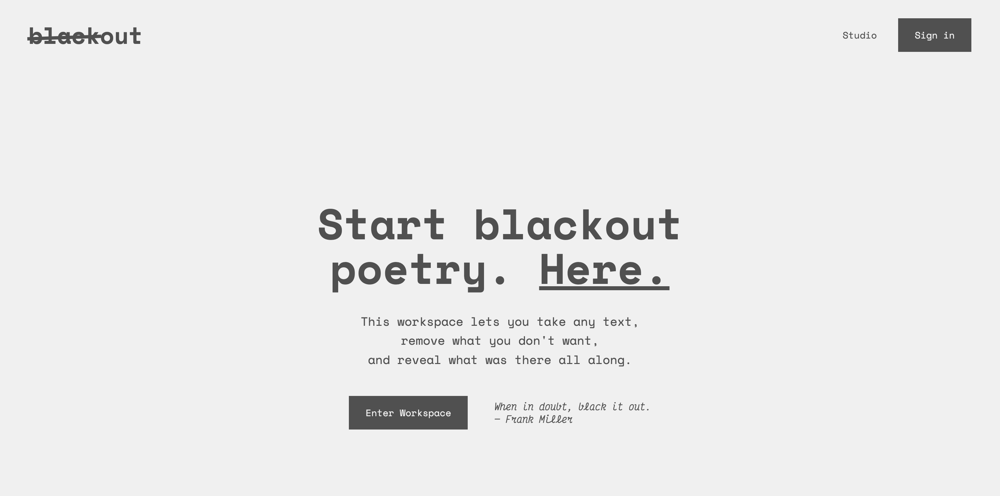
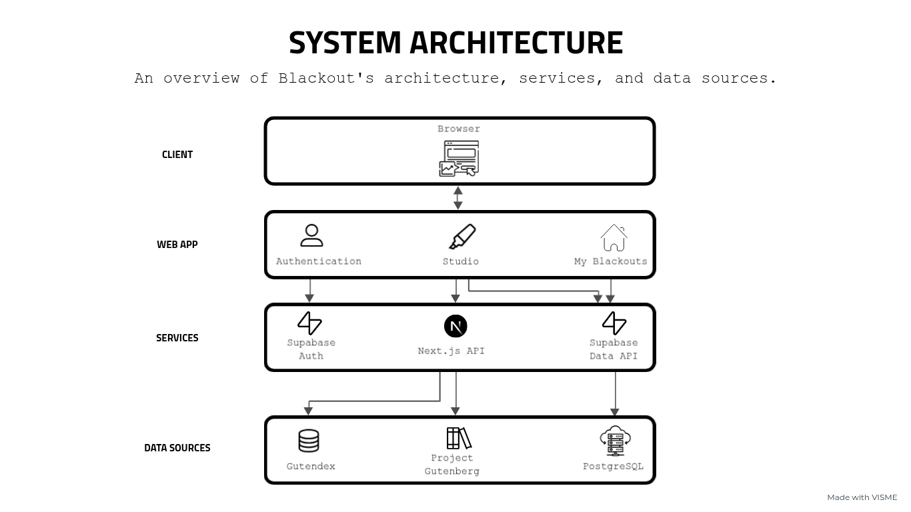

  <h3 align="center" style="font-size: 2.1em; font-weight: bolder;">Blackout</h3>

  <p align="center">
    A creative workspace for making and saving blackout poetry.
    <br />
    <br />
    <a href="https://github.com/ninoestrada/Blackout/issues/new">Report Bug</a>
    ·
    <a href="https://github.com/ninoestrada/Blackout/issues/new">Request Feature</a>
  </p>



<!-- ABOUT THE PROJECT -->

## 📖 About the Project

**Blackout** is a quiet tool for uncovering meaning inside existing language. You begin with a page of text. You conceal most of it. What remains becomes the poem.

Inspired by an interest in blackout poetry and its approachable, playful nature, the project aims to make poetry feel less intimidating and more accessible. Rather than starting with a blank page, users can discover new meaning in existing words, turning ordinary passages into something personal and expressive.

Blackout was created to bring more of the freedom and creativity of physical blackout poetry into a digital space. Beyond simply concealing words, the application combines blackout and drawing tools, allowing users to experiment with visual expression, personalize their poems, and save or share their creations as images.

### ✨ Features

- **Blackout Poetry Editor:** Create poems by blacking out words from existing text.
- **Drawing Tools:** Personalize poems with freehand drawings, adjustable colors, and brush sizes.
- **Undo & Redo:** Revisit and restore changes while editing poems.
- **Google Sign-In:** Sign in with Google to access saved poems.
- **Poem Management:** Save, view, edit, and delete poems from a personal collection.
- **PNG Export:** Download finished poems as images to keep or share.

<!-- DEFINITION -->

## 🖋 What Is Blackout Poetry?

Blackout poetry is a form of found poetry where you take an existing text and conceal most of it, leaving selected words visible to create a new meaning or message.

Much like sampling in hip-hop or creating street art, blackout poetry transforms something that already exists into something personal and expressive. It also blends literary and visual art, where the arrangement of words, negative space, and illustrations can become part of the poem itself. The result is a playful, approachable form of poetry that invites experimentation without starting from a blank page.

### **🛠️ Tech Stack**

|                    Front-End                    |                 Back-End                  |
| :---------------------------------------------: | :---------------------------------------: |
| [![TypeScript][TypeScript.com]][TypeScript-url] | [![Supabase][Supabase.com]][Supabase-url] |
|        [![React][React.com]][React-url]         | [![Postgres][Postgres.com]][Postgres-url] |
|     [![Next.js][Next.js.com]][Next.js-url]      |                                           |

## 🏗️ Architecture

The diagram below illustrates Blackout's architecture, including its Next.js application, Supabase services, and external text sources.



<!-- GETTING STARTED -->

## 📦 Getting Started

### **💾 Installation**

**Prerequisites:** Node.js 20.9 or later and npm.

1. Clone the repository and navigate to the project directory.
   ```sh
   git clone https://github.com/ninoestrada/Blackout.git
   cd Blackout
   ```
2. Install dependencies.
   ```sh
   npm install
   ```
3. Create a project in the [Supabase dashboard](https://supabase.com/dashboard).
4. Create a `.env.local` file in the project root and add your Supabase project URL and publishable key from the dashboard.
   ```env
   NEXT_PUBLIC_SUPABASE_URL=your-supabase-project-url
   NEXT_PUBLIC_SUPABASE_PUBLISHABLE_KEY=your-supabase-publishable-key
   ```
5. Set up the database using the SQL files in `supabase/migrations`.
6. Configure Google sign-in through Supabase Authentication, including Google OAuth credentials and the appropriate redirect URLs for `/auth/callback`.

### **▶️ Running the Program**

```sh
npm run dev
```

Open [http://localhost:3000](http://localhost:3000) in your browser, or use the local URL shown in your terminal.

### 🧪 Testing

Blackout includes automated tests to check that the poetry editor behaves as expected, particularly when making changes to the application.

To run the tests locally:

```sh
npm test
```

<!-- LICENSE -->

## 📜 License

Distributed under the MIT License. See [`LICENSE`](LICENSE) for more information.

<!------- MARKDOWN LINKS & IMAGES ------->

[React.com]: https://img.shields.io/badge/React-20232A?style=for-the-badge&logo=react&logoColor=61DAFB
[React-url]: https://react.dev/
[TypeScript.com]: https://img.shields.io/badge/TypeScript-3178C6?style=for-the-badge&logo=typescript&logoColor=white
[TypeScript-url]: https://www.typescriptlang.org/
[Next.js.com]: https://img.shields.io/badge/Next.js-000000?style=for-the-badge&logo=nextdotjs&logoColor=white
[Next.js-url]: https://nextjs.org/
[Supabase.com]: https://img.shields.io/badge/Supabase-3ECF8E?style=for-the-badge&logo=supabase&logoColor=white
[Supabase-url]: https://supabase.com/
[Postgres.com]: https://img.shields.io/badge/PostgreSQL-4169E1?style=for-the-badge&logo=postgresql&logoColor=white
[Postgres-url]: https://www.postgresql.org/
